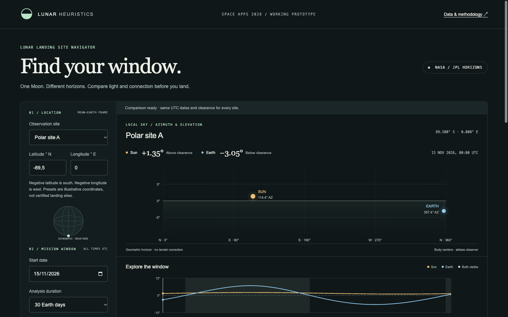

# Lunar Heuristics

A working NASA Space Apps 2026 **Lunar Landing Site Navigator** prototype. Compare Sun and Earth visibility at lunar coordinates using actual NASA/JPL Horizons ephemerides.

**[Open the public demo](https://lunar-heuristics.vercel.app)** · **[Source repository](https://github.com/medeeam/lunar-heuristics)**



## Run locally

Requirements: Python 3.10+ and curl. Node 22+ is needed only for JavaScript tests and the optional npm command aliases. No package installation or API key is required.

```sh
python3 server.py
# open http://localhost:8000
```

`npm start` is an equivalent convenience command. The server binds only to 127.0.0.1. Do not expose this development server directly to the public internet.

## Try the demo

1. Explore Polar site A, starting 15 November 2026, for 30 days.
2. Drag the timeline and observe Sun/Earth elevation relative to the horizon.
3. Increase clearance to 2° to demonstrate sensitivity to an obstruction.
4. Compare the three reference locations and open the equatorial result.
5. Download CSV data and the raw provenance record from Data & methodology.
6. Enter custom coordinates or dates and calculate a new live JPL scenario.

The three presets are illustrative sample coordinates, not terrain-derived or approved landing sites. Preset data for 15 November–15 December 2026 is bundled and works without an internet connection once the site is served. Other locations and date ranges need internet access through the local Python server or hosted API. Results remain visible if a new request fails.

## What is implemented

- Airless topocentric Sun and Earth azimuth/elevation from NASA/JPL Horizons.
- Site and date selection, hourly time slider and user-triggered playback.
- Quantitative local-sky and elevation-over-time diagrams.
- Side-by-side reference-site comparison for the same dates and clearance.
- Integrated visibility percentages and linearly interpolated joint windows.
- Time to set below the selected clearance, bounded by the analysis interval.
- Horizontal-panel solar incidence factor (not electrical power output).
- CSV and full provenance downloads; input validation and partial/error states.
- Responsive, keyboard-operable interface with text equivalents for charts.

## Science and limits

Horizons observer center: `coord@301`. Targets: Sun `10`, Earth `399`. Coordinates: east-positive longitude and planetodetic latitude in degrees, altitude 0 km above the lunar reference surface. Quantity `4` supplies airless apparent azimuth and elevation of target centers. The response identifies the lunar orientation model and ephemeris source. Horizons handles orientation/libration; we do not implement a separate approximation.

The zero-elevation horizon is the plane perpendicular to local reference-surface zenith. **No LOLA terrain model is currently included.** Clearance adds a uniform test mask, not measured topography. Terrain, slopes, local horizon dip, eclipses and disk/limb effects are not modeled. Solar visibility is a center-angle condition. Earth-center visibility does not guarantee a usable ground-station link.

For every adjacent hourly sample pair, the algorithm linearly interpolates elevation, finds the portions satisfying each clearance inequality, intersects them for joint visibility, and merges contiguous intervals. Percentages are duration-weighted, not percentages of sampled points. Boundary-clipped windows are marked. An hourly cadence can miss short events; sub-hour precision in displayed estimates does not imply validated timing accuracy.

Solar factor is `max(0, sin(elevation))`, set to zero when below clearance. It describes incidence on a horizontal panel and excludes efficiency, thermal losses, eclipses, tracking arrays, and solar flux variation. It must not be interpreted as generated watts.

## Data provenance

`public/data/*.json` stores parsed samples, exact query parameters, API URLs, retrieval times, and raw JPL responses for three sites. Rebuild with:

```sh
python3 scripts/fetch_demo.py
```

JPL requests are serialized and cached in `.cache/`. The browser first uses bundled data when a request falls within its coverage. No simulated or fabricated ephemerides are substituted on failure.

## Verification

```sh
npm test
```

Tests cover interpolated crossings, joint windows, fully visible and empty states, boundary clipping, solar incidence, bundled-data time/range integrity, date slicing, invalid input and upstream parsing. Browser observations are recorded in `docs/qa/` when available. These are software checks, not independent flight-quality scientific validation.

## Project layout

- `server.py`: static server, validated JPL proxy, cache and parser.
- `public/model.js`: pure visibility analysis.
- `public/app.js`: interaction, visualization and exports.
- `public/index.html`, `public/styles.css`: accessible application interface.
- `public/data/`: reproducible NASA data.
- `docs/submission.md`: editable submission narrative and demo script.

## Sources and attribution

- [Official challenge](https://www.spaceappschallenge.org/2026/challenges/lunar-landing-site-navigator/)
- [NASA/JPL Horizons manual](https://ssd.jpl.nasa.gov/horizons/manual.html)
- [NASA/JPL Horizons API](https://ssd-api.jpl.nasa.gov/doc/horizons.html)
- [LROC QuickMap](https://quickmap.lroc.asu.edu/) and [NASA Moon Trek](https://trek.nasa.gov/moon/) are linked for further terrain exploration; their terrain datasets are not ingested by this version.

Original project code: MIT license, see LICENSE. NASA/JPL data and linked resources retain their source attribution and applicable terms. This project is not endorsed by NASA.

## Hosted deployment

The public version uses the same interface and datasets on Vercel, with `api/scenario.js` adapting the fetch handler in `worker/index.js`. It preserves the Python service’s validation, hourly sampling, source records, and sequential Sun/Earth requests. Successful queries use a bounded, best-effort in-memory cache per runtime instance and a 24-hour browser cache policy. No API keys are required.

Run `npm run build` to produce a standalone `dist/server/index.js` with embedded public assets and the live ephemeris endpoint. Tests compare hosted-handler results against the Python-generated NASA fixtures. Local Python development still works with `python3 server.py`.
